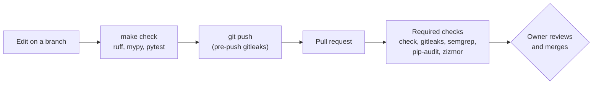

<p align="center">
  <a href="https://bearingquest.com">
    <picture>
      <source media="(prefers-color-scheme: dark)" srcset="docs/readme/bearing-quest-lockup-on-dark.svg">
      
    </picture>
  </a>
</p>

<h1 align="center">project-template</h1>

<p align="center">
  The template new Bearing Quest projects start from.<br>
  Part of the <a href="https://bearingquest.com">Bearing Quest</a> project family.
</p>

<p align="center">
  <a href="https://github.com/BearingQuest/project-template/actions/workflows/ci.yml"></a>
  <a href="https://scorecard.dev/viewer/?uri=github.com/BearingQuest/project-template"></a>
  <a href="LICENSE"></a>
  
</p>

The template every new BearingQuest project is created from. It meets
engineering baseline 2.0 itself, so a new repository starts with the local
gates, the five required CI checks, the ruleset files and the repo docs already
in place. The code is a placeholder: a `project_template` package with a Typer
CLI, `pt`, a pydantic-settings configuration module, structured JSON logging,
typed errors and one pure domain function.

> [!TIP]
> Start a new project with **Use this template** on GitHub, then follow [After "Use this template"](#after-use-this-template) in one pull request.


Requires Python 3.14 and [uv](https://docs.astral.sh/uv/).

```console
$ uv sync
$ uv run pt version
$ uv run pt hello --name Ada
```

Errors print one plain line to stderr and exit 1 (Typer usage errors exit 2);
users never see a stack trace.

## Configuration

Settings are read from environment variables with the `PT_` prefix, only in
`src/project_template/config.py`. An invalid value stops the command with an
error that names the setting, not its value.

| Variable | Default | Allowed values |
| --- | --- | --- |
| `PT_LOG_LEVEL` | `INFO` | `DEBUG`, `INFO`, `WARNING`, `ERROR`, `CRITICAL` |
| `PT_MAX_NAME_LENGTH` | `50` | an integer from 1 to 200 |

Logs are JSON, one object per line, on stderr, each with a request ID. They
never include secrets or free text from users.

## Checks

```console
$ make help    # list the targets
$ make check   # ruff lint, ruff format check, mypy (strict), pytest with an 85% coverage floor
$ make audit   # pip-audit every package locked in uv.lock, as CI does
$ make sbom    # CycloneDX SBOM of the runtime dependencies in dist/sbom.cdx.json
$ make hooks   # use .githooks/pre-push, which runs gitleaks on the commits being pushed
```

CI (`.github/workflows/ci.yml`) runs five jobs on every pull request and every
push to `main`: `check`, `gitleaks`, `semgrep`, `pip-audit` and `zizmor`.
`.github/rulesets/main.json` requires all five. The ruleset files are for the
owner to apply; nothing in this repository applies them.



Dependencies are exact-pinned and locked in `uv.lock`. `[tool.uv] exclude-newer =
"7 days"` makes `uv lock` ignore releases newer than seven days.

## After "Use this template"

Do these in the new repository, in one pull request:

1. Rename the package directory `src/project_template/` to `src/<new_name>/` and
   update every import (`project_template` in `src/`, `tests/`, and the
   `--cov=project_template` and `files = ["src/project_template"]` entries in
   `pyproject.toml`).
2. In `pyproject.toml`, set `name` and `description`, and change the script to
   `<command> = "<new_name>.cli:app"`. Update the `project-template` name in
   `src/<new_name>/__init__.py`, then run `uv lock`.
3. Change the `PT_` prefix: `env_prefix` in `config.py`, the table above, and the
   tests that set `PT_*` variables.
4. In `.github/rulesets/main.json`, keep the required checks in step with the jobs
   in `ci.yml` (`check`, `gitleaks`, `semgrep`, `pip-audit`, `zizmor`). If you add
   or remove a job, update `REQUIRED_CHECKS` in `tests/test_workflows.py` too.
5. Rewrite this README: what the project is, its configuration table, how to run it.
   Keep the family header and its two lockups in `docs/readme/`; change the name, the
   one-line description and the repository name in each badge URL; keep the Scorecard
   badge only while `scorecard.yml` publishes results. Replace the commands in
   `docs/readme/demo.tape`, run `vhs docs/readme/demo.tape` to re-record `demo.gif`,
   and update the diagram. `tests/test_readme.py` checks the images.
6. Reset `CHANGELOG.md` to an empty `Unreleased` section.
7. In `.github/SECURITY.md`, replace the `BearingQuest/project-template` repository
   URL, and adjust the scope section.
8. Replace the rows in `docs/decisions.md` with one first row for the new
   repository (what it is, the template version it started from), then add a row
   for each tool or library you add or change.
9. Update `AGENTS.md` (name, layout) and keep the human-gate list.
10. Run `make hooks`, then `make check` and `make audit`.

## Licence

MIT. See [LICENSE](LICENSE).
